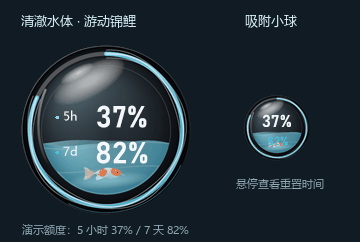

# codexQuotadisplay

Codex 套餐剩余额度桌面挂件。当前版本 **1.2.0**。

版本历史见 [更新日志](CHANGELOG.md)，本次发布说明见 [1.2.0](releases/v1.2.0.md)。
GitHub 源码不包含构建产物，安装包与便携包通过仓库的 Releases 页面提供。

适用于 **Windows 11 x64**。安装版包含官方 Codex 额度读取组件，不需要用户另外安装 Node.js、Python、Codex CLI 或开发工具。界面使用 Windows 自带的 .NET Framework 4.8。

## 给其他人安装

分发 `dist/CodexUsageWidget-Setup-1.2.0-win-x64.exe`。对方双击安装，从桌面或开始菜单运行即可。安装到当前 Windows 用户目录，无需管理员权限；可在 Windows 应用列表卸载。`dist` 中也提供免安装 ZIP，解压后运行 `CodexQuotaWidget.exe`。

安装包只包含程序、官方读取组件、使用说明和许可证。**不包含制作者的 settings.json、账号、令牌、登录文件或历史用量。** `dist/SHA256SUMS.txt` 可校验安装包和便携包。

挂件读取当前 Windows 用户、本机 Codex 已保存的登录状态。读取到 ChatGPT 账号及套餐数据时显示该账号额度；不会固定显示制作者的额度。仅在浏览器或远程设备登录、其他 Windows 用户的登录、只存在于某个宿主进程内的临时会话，不保证能被读取。

账号状态通过官方 `account/read` 判断，套餐用量通过 `account/rateLimits/read` 读取。登录缓存可能位于当前用户的 `.codex` 目录或系统凭据存储，遵循本机 Codex 配置。详见 [OpenAI 账号接口文档](https://learn.chatgpt.com/docs/app-server#authentication-modes) 和 [登录缓存文档](https://learn.chatgpt.com/docs/auth#login-caching)。

## 状态提示

| 情况 | 面板显示 |
| --- | --- |
| 本机没有可读取的登录账号 | 未登录 Codex / 没有找到本机账号信息 |
| 使用 API Key 或其他云服务认证 | 找不到套餐额度，并提示使用 ChatGPT 账号登录 |
| 服务没有返回 Codex 套餐额度 | 找不到套餐额度 |
| 登录已失效 | Codex 登录已失效，请重新登录 |
| 网络异常或读取超时 | 暂时无法获取额度 / 读取额度超时 |

未登录或读取失败时不显示虚假的 0%，也不保留旧账号额度。登录或切换账号后，每 60 秒自动检测；也可点击面板的“重新检测”或右键立即刷新。

## 显示与操作

默认使用 **双额度能量球**：球内水量表示 5 小时剩余额度，外侧细环表示 7 天剩余额度，球心分别显示两组百分比，旁边的 `5h` / `7d` 与颜色对应。水量按圆形容器面积计算，不混合或平均两个额度。主界面只显示额度；标题、套餐名称、刷新时间和重置时间不常驻显示。

鼠标悬停在球面时，提示两组额度各自的本地重置日期、时刻及剩余时长。缺失时间会明确提示暂未提供。水体固定为清澈浅蓝色，不受外观主题影响；红白鲤鱼在水下摆尾、游动和转身，低水位时缩小游动范围，静态模式会暂停游动。外观颜色菜单仅控制球壳、外环和其他图表。

球体图形采用 3 倍分辨率渲染；吸附小球使用 4 倍分辨率，再以预乘透明度缩回显示尺寸，平滑处理外沿、流光和水面。数字在原尺寸单独绘制。球面具有柔和高光、边缘暗部、外环厚度与底部折射，静态光影会缓存以降低动效开销。

能量球默认 176 像素，可调整到 128–280 像素。右键“大小”或按住 Ctrl 滚动滚轮可缩放，也可拖动球体右下侧外缘缩放。原有五种图表仍可选用，已移除常驻标题和页脚，面板宽度可调为 220–480 像素。

拖到屏幕工作区任一边缘约 22 像素内会自动吸附，并缩为 68 像素能量球，小球仍显示两个百分比。悬停平滑展开，移开约 650 毫秒后收起；拖离边缘即可恢复正常大小。右键可关闭自动吸附或手动取消吸附。吸附位置按显示器和边缘位置保存，重启可恢复。

右键“始终置顶”可开启或关闭置顶。吸附不会改变此设置。其余菜单可设置主题、自定义强调色、材质、动效、速度、重新检测、查看账号状态或退出。双击能量球也可刷新。不置顶时，其他窗口可以正常覆盖它。

安装版与便携版的外观设置保存在 `%LOCALAPPDATA%\CodexUsageWidget\settings.json`。卸载保留这些外观设置和原有 Codex 登录信息。挂件不导出登录令牌，不向制作者服务器上传信息，不发送模型对话或消耗推理额度。官方组件会按照本机配置请求账号服务并管理已有登录会话。

## 构建与验证

源代码启动：双击 `启动挂件.vbs`。此方式使用本机已有的 Codex 组件，供开发调试；正式分发使用 `dist` 安装包。

在 Windows PowerShell 中运行 `packaging/download-runtime.ps1` 下载并校验固定版本的官方运行组件，再运行 `build.ps1` 生成原生 EXE、安装包、便携包及 SHA256 校验文件。构建使用 Windows 的 C# 编译器，正式程序不依赖 PowerShell 脚本。

`tests` 包含协议模拟和状态转换检查，包括未登录、API Key、无额度、登录失效、网络失败、账号切换、退出后清除旧数据，以及官方组件在空登录目录、没有 Node/CLI 的 PATH 环境下的检测。测试不退出或修改本机真实账号。

`previews` 中的图片是演示数值，不代表实际用量。官方组件采用 Apache-2.0 许可，对应许可证与 NOTICE 随包提供。此挂件是独立社区工具，不是 OpenAI 官方产品。
